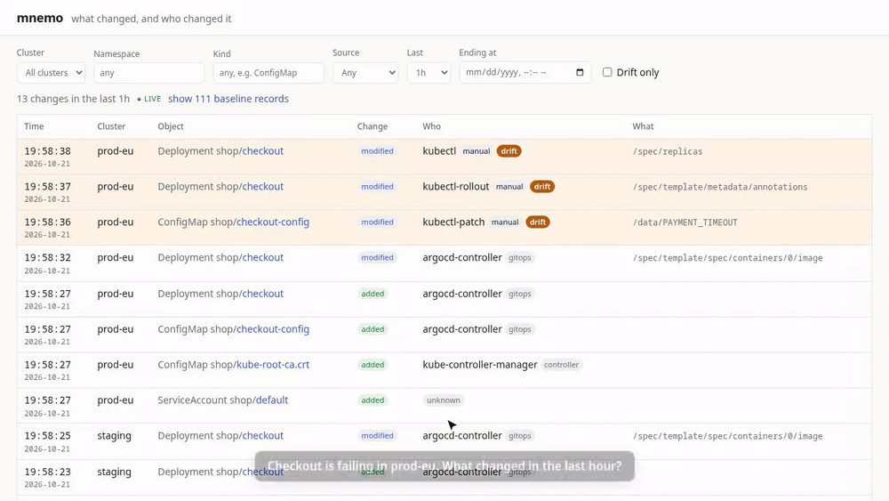

# mnemo

A time machine for Kubernetes cluster state.

> What did this Deployment / ConfigMap / RoleBinding look like at 14:32 yesterday, and who changed it?

Audit logs are raw and noisy. GitOps only covers what lives in Git. mnemo watches live
resources across all your clusters, keeps every version, and answers *"what changed in the
last 30 minutes, and who did it?"*, flagging manual changes that bypassed GitOps.

<picture>
  <source media="(prefers-color-scheme: dark)" srcset="docs/demo-dark.gif">
  
</picture>

**Why mnemo:** open source, self-hosted, your data never leaves your infrastructure, and you
can reconstruct any object at any point in time, not just get notified that it changed.

**Status:** v0.1, early. Works end to end; expect rough edges. See [ROADMAP.md](ROADMAP.md).

## Features

- **Change feed** across clusters: every change with who made it, which fields changed, and
  whether it came from GitOps, a controller, or a human.
- **Drift:** manual changes to GitOps-managed objects (Argo CD, Flux) are flagged.
- **Time travel:** any object's full history, YAML diffs between versions, and its exact
  state at any moment.
- **Day-one value:** on install, every object is recorded with who last touched it.
- **Events archive:** Kubernetes Events are kept past their ~1h lifetime and shown on each
  object's timeline, with a Deployment's ReplicaSet and Pod events next to the change that
  caused them.
- **Webhooks:** POST matching changes to Slack or your own receiver, signed, at least once
  and in order. See [docs/webhooks.md](docs/webhooks.md).
- **Multi-cluster:** one hub, one lightweight agent per cluster. Agents push, so the hub never
  needs credentials for your clusters.
- **SSO and per-team access:** OIDC (Okta, Entra ID, Google, Keycloak, Dex, ...) or an auth
  proxy; a policy maps groups to clusters and namespaces. See [docs/auth.md](docs/auth.md).
- **Read-only and small:** get/list/watch on what you choose to watch, nothing else. Secrets
  are never recorded. One ~30 MB image.

## Install

Single cluster, hub and agent in one pod:

```sh
helm install mnemo oci://ghcr.io/guipguia/charts/mnemo -n mnemo --create-namespace \
  --set agent.cluster=prod
kubectl -n mnemo port-forward svc/mnemo 8080:80   # then open http://127.0.0.1:8080
```

More clusters: install the chart there with `mode=agent`, pointing at the hub:

```sh
# On the hub cluster: read its token.
kubectl -n mnemo get secret mnemo-token -o jsonpath='{.data.token}' | base64 -d

# On each other cluster:
kubectl create namespace mnemo
kubectl -n mnemo create secret generic mnemo-hub-token --from-literal=token=<token>
helm install mnemo oci://ghcr.io/guipguia/charts/mnemo -n mnemo \
  --set mode=agent --set agent.cluster=staging \
  --set agent.hubURL=https://mnemo.example.com --set token.existingSecret=mnemo-hub-token
```

Expose the hub with `hub.ingress.*` and turn on login with `hub.auth.*` before giving
others access: with the default `hub.auth.mode=none`, anyone who can reach it sees all
history. All options: [charts/mnemo/values.yaml](charts/mnemo/values.yaml).

History lives in SQLite on a PersistentVolume (block storage, not NFS), kept on
`helm uninstall`, and is kept forever by default. Cap it with `hub.retention.days` and
`hub.retention.versions` (per object); each object's current state is never expired.
Archived Events expire after `hub.retention.eventDays` (30 by default).
For backups, `hub.backup.*` adds a [Litestream](https://litestream.io) sidecar that streams
the database to S3, GCS, Azure Blob or SFTP; on an empty volume the hub restores from it
before starting.

**Try it:** [`demo/incident.sh`](demo/incident.sh) replays the incident from the GIF on any
cluster mnemo watches: an Argo CD-managed app, then someone hot-fixing it by hand.

## How it works

- **Agent** (one per cluster): watches the configured kinds, strips noise (`status`,
  `resourceVersion`, `managedFields`, ...), and pushes full objects to the hub. Stateless:
  it resumes from checkpoints the hub keeps, and catches up after outages.
- **Hub:** dedupes, diffs, and works out who made each change from field ownership in
  `managedFields`; stores history (SQLite now, PostgreSQL and MySQL planned) and serves the
  API and UI.
- **Attribution** names the tool (`kubectl-edit`, `argocd-controller`, ...). On
  self-managed clusters, the API server's audit webhook can name the person instead:
  [docs/audit.md](docs/audit.md).

Design details: [docs/design.md](docs/design.md).

## Contributing

See [CONTRIBUTING.md](CONTRIBUTING.md). All commits require a DCO sign-off (`git commit -s`).

## Community

- Code of Conduct: [CNCF Code of Conduct](CODE_OF_CONDUCT.md)
- Governance: [GOVERNANCE.md](GOVERNANCE.md)
- Security issues: [SECURITY.md](SECURITY.md), never public issues

## License

[Apache 2.0](LICENSE)
